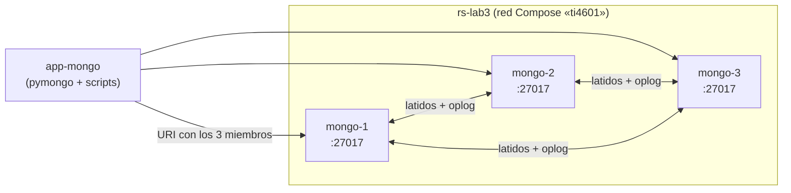

# Laboratorio 3 — Conjuntos de réplicas en MongoDB: mayoría, elección y durabilidad

**Valor:** 2,5 % del curso 

**Motor:** MongoDB 8.0, conjunto de réplicas de 3 nodos  
**Asignación:** miércoles 21 de octubre de 2026 · **Plazo:** 2 semanas  
**Entrega:** Martes 3 de noviembre de 2026, 11:00 pm, el informe en PDF (uno por equipo) en TEC Digital, con el enlace al repositorio.  

---

## 1. Qué aprenderemos

Al terminar, podrá:

1. levantar tres procesos `mongod` y convertirlos en un conjunto de réplicas con `rs.initiate()`, explicando cada campo de la configuración;
2. leer `rs.status()`, `rs.conf()` y el *oplog* para identificar el primario, los secundarios, el término de la elección y el retraso de replicación;
3. cargar documentos con garantía de **mayoría** y verificar la carga contra un manifiesto con suma SHA-256;
4. demostrar que una operación sobre **un solo documento** es atómica, y usarla para vender entradas sin vender de más;
5. medir cuánto cuestan `w:1`, `w:1 + journal`, `w:majority` y `w:3`;
6. medir cuántas lecturas en un secundario son obsoletas según la garantía usada, y relacionarlo con el teorema CAP/PACELC;
7. provocar la caída de un secundario, del primario y de la mayoría del conjunto, y calcular **RTO** y **RPO** sobre lo confirmado;
8. explicar por qué un error de escritura **no** significa que el dato no se escribió.

---


## 2. Modelo mental: de Raft en CockroachDB a un conjunto de réplicas


### 2.1 Topología del laboratorio




| Servicio    | Contenedor       | Volumen               | Publicado al host |
| ----------- | ---------------- | --------------------- | ----------------- |
| `mongo-1`   | `ti4601-mongo-1` | `mongo1`              | no                |
| `mongo-2`   | `ti4601-mongo-2` | `mongo2`              | no                |
| `mongo-3`   | `ti4601-mongo-3` | `mongo3`              | no                |
| `app-mongo` | (efímero)        | repositorio en `/src` | no                |


Compose arranca cada nodo con:

```text
mongod --replSet rs-lab3 --bind_ip_all --wiredTigerCacheSizeGB 0.25
```


### 2.2 Vocabulario


| Término                                        | Qué es                                                                                                                                                           |
| ---------------------------------------------- | ---------------------------------------------------------------------------------------------------------------------------------------------------------------- |
| **Primario**                                   | El único nodo que acepta escrituras. Los demás son secundarios.                                                                                                  |
| **Secundario**                                 | Copia el *oplog* del primario y lo aplica. Puede servir lecturas si el cliente lo permite.                                                                       |
| **Oplog**                                      | Colección capada `local.oplog.rs` con cada operación de escritura en orden. Es el mecanismo de replicación.                                                      |
| **Término** (`term`)                           | Número que sube con cada elección. Equivale al término de Raft.                                                                                                  |
| **Elección**                                   | Cuando un secundario no oye al primario durante `electionTimeoutMillis` (10 s por defecto), pide votos. Gana quien consigue **mayoría de los nodos con voto**.   |
| **Mayoría**                                    | `⌊n/2⌋ + 1` nodos votantes: 2 de 3, 3 de 5.                                                                                                                      |
| **Write concern** (`w`, `j`, `wtimeout`)       | Qué debe cumplirse antes de que el servidor responda «confirmado»: `w:1` (solo el primario), `w:"majority"`, `w:3`; `j:true` exige además el *journal* en disco. |
| **Read preference**                            | A qué nodo dirige el cliente una lectura: `primary` (defecto), `secondary`, etc.                                                                                 |
| **Read concern**                               | Qué garantía de visibilidad tiene lo que se lee (`local`, `majority`).                                                                                           |
| **Escritura reintentable** (*retryable write*) | El driver reintenta una vez una escritura que falló por un cambio de primario, sin duplicarla.                                                                   |


### 2.5 Límites de este laboratorio

- Los tres nodos corren en **una sola computadora**: no hay latencia de red real, y las fallas son contenedores detenidos, no particiones.
- No hay autenticación ni TLS. No use esta configuración fuera del laboratorio.
- RAM: cada nodo usa cerca de 300–500 MB. Se recomiendan 4 GB libres.

---


## 3. Qué se entrega y qué debe hacer

El repositorio entrega infraestructura y herramientas de observación; **no** entrega un botón que configure y ejecute todo el laboratorio.


| Ya se proporciona                                 | Trabajo del estudiante                                                                        |
| ------------------------------------------------- | --------------------------------------------------------------------------------------------- |
| Compose con tres `mongod` y cliente `app-mongo`   | leer las opciones del Compose; levantar; ejecutar `rs.initiate()` con su propia configuración |
| `generar_datos.py` (semilla y manifiesto)         | verificar que su carga reproduce el manifiesto                                                |
| `cargar.py` (estructura y verificaciones)         | **TODO 1** carga por lotes · **TODO 2** índices compuestos                                    |
| `comprar.py` (prueba concurrente)                 | **TODO 3** compra atómica e idempotente                                                       |
| `bench_write_concern.py` (variantes, CSV)         | **TODO 4** la función que mide                                                                |
| `lectura_secundario.py`, `sonda_escrituras.py`    | ejecutarlas, coordinar las fallas, guardar evidencia y explicar                               |
| `verificar_rpo.py` (lectura del CSV y de la base) | **TODO 5** clasificar confirmados, desconocidos y perdidos                                    |
| `verify_replica.py`                               | corregir su configuración hasta `6/6`                                                         |


Cada TODO está marcado en el código, trae instrucciones paso a paso y termina en un `raise NotImplementedError` que usted debe reemplazar. Después de cada TODO el script corre una **verificación automática** (`OK:` o `VERIFICACIÓN FALLÓ:`). No cambie las firmas de las funciones: las verificaciones dependen de ellas.

El `Makefile` solo conserva atajos de **infraestructura** (`lab3-up`, `lab3-status`, `lab3-shell`, `lab3-app`, `lab3-check`, `lab3-down`). No existe un objetivo que inicialice el conjunto, mida o provoque fallas.

## 4. Cómo usar esta guía

Trabaje en orden. Cada paso termina con un **resultado esperado** y un **punto de control**. 

Los bloques llevan uno de estos contextos:

- **HOST:** terminal en la raíz del repositorio;
- **APP:** shell del contenedor `app-mongo`, abierto con `make lab3-app` (aquí se ejecutan los scripts de Python; el directorio de trabajo es `/src`);
- **MONGOSH:** prompt de `mongosh` dentro de un nodo, abierto con `make lab3-shell` (por defecto en `mongo-1`; use `make lab3-shell NODE=mongo-2` para otro).

No ejecute comandos de HOST dentro de `mongosh`, ni JavaScript de `mongosh` en Bash. Los scripts de Python **no** se instalan en su computadora: se ejecutan siempre en el contenedor.

Para abreviar, en APP se escribe `python3 labs/lab3-mongo-replicas/<script>`; desde HOST el mismo comando es:

```bash
docker compose --profile lab3 run --rm --no-deps app-mongo \
  python3 labs/lab3-mongo-replicas/<script>
```

Use siempre `--no-deps`: sin esa opción Compose intenta arrancar o esperar a los nodos que usted detuvo a propósito.

**Nodo y contenedor.** `rs.status()` nombra a cada nodo `mongo-N:27017`; su contenedor es `ti4601-mongo-N`. Cuando la guía diga «sustituya `N`», use ese número.

### Ruta completa y evidencia


| Paso | Trabajo                         | Puede avanzar cuando…                      | Evidencia                                 |
| ---- | ------------------------------- | ------------------------------------------ | ----------------------------------------- |
| 0    | preparar y construir            | existe `evidence/` y la imagen             | —                                         |
| 1    | leer Compose y levantar         | 3 contenedores sanos, sin conjunto         | `cluster-start.txt`                       |
| 2    | `rs.initiate()`                 | hay 1 primario y 2 secundarios             | informe                                   |
| 3    | inspeccionar el conjunto        | puede explicar `rs.status()` y `rs.conf()` | `rs-inspect.txt`                          |
| 4    | generar la semilla              | existe `data/MANIFEST.json`                | `datos-manifest.txt`                      |
| 5    | cargar (TODO 1 y 2)             | `lab3-check` termina `6/6`                 | `config-check.txt`, `explain-indices.txt` |
| 6    | observar el oplog y el retraso  | vio su escritura en el oplog               | `oplog.txt`                               |
| 7    | lecturas en secundario          | tabla de lecturas obsoletas                | `lectura-secundario.{txt,csv}`            |
| 8    | compra atómica (TODO 3)         | todas las líneas `OK:`                     | `comprar.txt`                             |
| 9    | costo de las garantías (TODO 4) | 4 variantes, n ≥ 300                       | `write-concern.{txt,csv}`                 |
| 10   | RPO (TODO 5) y línea base       | `--autotest` pasa; RPO base = 0            | `rpo-baseline.{csv,txt}`                  |
| 11   | Falla A: un secundario          | sonda sin errores; nodo recuperado         | `falla-a*`                                |
| 12   | Falla B: el primario            | RTO y RPO calculados                       | `falla-b*`                                |
| 13   | Falla C: sin mayoría            | errores que sí se escribieron              | `falla-c*`                                |


Lleve un **registro de comandos** en `evidence/comandos.md`: el comando, el resultado y la hora de cada punto de control, y marque cada paso como `OK` antes de pasar al siguiente. Las predicciones, las respuestas a las preguntas y el análisis van en el **informe** (el PDF que se entrega, sección 12). Escriba cada predicción en el informe **antes** de ejecutar el paso correspondiente.

**Si reanuda un intento anterior:** ejecute `make lab3-status` y `make lab3-check`; continúe desde el primer `[FAIL]`. No use `lab3-down-v` «para probar suerte»: borra el estado que debe aprender a diagnosticar.

---


## 5. Preparar y levantar


### Paso 0 — requisitos

- Docker Engine + Compose v2 (`docker compose version`).
- 4 GB de RAM libres y 3 GB de disco (la imagen `mongo:8.0` pesa cerca de 1 GB).
- Ejecutar todo desde la raíz del repositorio.
- Si tiene levantados el Lab 1 o el Lab 2, apáguelos (`make lab1-down`, `make lab2-down`) para liberar memoria.

**HOST**

```bash
docker compose version
make build                # la imagen del curso ahora incluye pymongo
mkdir -p evidence
test -f evidence/comandos.md \
  || printf '# Registro de comandos — Laboratorio 3\n\n' > evidence/comandos.md
```


### Paso 1 — interpretar Compose antes de ejecutarlo

Abra `docker-compose.yml` y localice los servicios `mongo-1`, `mongo-2` y `mongo-3`. Complete en su informe:


| Servicio  | `--replSet` | `hostname` | volumen | ¿publica puertos? |
| --------- | ----------- | ---------- | ------- | ----------------- |
| `mongo-1` |             |            |         |                   |
| `mongo-2` |             |            |         |                   |
| `mongo-3` |             |            |         |                   |


Luego levante los nodos:

**HOST**

```bash
date --iso-8601=seconds | tee evidence/cluster-start.txt
make lab3-up
make lab3-status | tee -a evidence/cluster-start.txt
```

**Resultado esperado:** tres contenedores `ti4601-mongo-N` en ejecución y, en la última línea, `conjunto no inicializado o nodo sin respuesta: NotYetInitialized`. Si la columna de estado dice `starting`, espere 10–20 s y repita `make lab3-status`.

### Punto de control del paso 1

Explique antes de continuar:

- por qué tres procesos `mongod` con el mismo `--replSet` todavía no forman un conjunto;
- por qué el nombre de `--replSet` es el que usted deberá escribir como `_id` de la configuración;
- por qué los nodos se nombran `mongo-1:27017` y no `localhost:27017`;
- qué perdería si elimina los volúmenes.

---


## 6. Configurar el conjunto de réplicas


### Paso 2 — inicializar con `rs.initiate()`

**HOST**

```bash
make lab3-shell
```

Cuando aparezca el prompt (`test>`), estará en el contexto **MONGOSH**. Verifique que el nodo todavía no pertenece a ningún conjunto:

```javascript
rs.status()
```

Debe responder `NotYetInitialized`. Ahora cree el conjunto. La configuración tiene esta forma; **sustituya cada marcador** `<...>` **por el valor correcto y no escriba literalmente los signos** `< >`**:**

```javascript
rs.initiate({
  _id: "<nombre del conjunto>",
  members: [
    { _id: 0, host: "<host:puerto del primer nodo>" },
    { _id: 1, host: "<host:puerto del segundo nodo>" },
    { _id: 2, host: "<host:puerto del tercer nodo>" }
  ]
})
```

Luego espere unos segundos y repita:

```javascript
rs.status().members.map(m => ({ name: m.name, state: m.stateStr, health: m.health }))
```

**Resultado esperado:** `{ ok: 1 }` al iniciar y, tras 5–15 s, un nodo `PRIMARY` y dos `SECONDARY`; el prompt cambia a `rs-lab3 [direct: primary] test>`.

Pistas si falla:


| Mensaje                                                                      | Causa probable                                             |
| ---------------------------------------------------------------------------- | ---------------------------------------------------------- |
| `Rejecting initiate with a set name that differs from command line set name` | el `_id` no coincide con `--replSet` del Compose           |
| `No host described in new configuration ... maps to this node`               | los `host` no son nombres que el nodo reconozca como suyos |
| `NotYetInitialized` tras mucho rato                                          | la sentencia falló; léala completa y repita                |
| `already initialized`                                                        | ya lo hizo: use `rs.status()`, no lo repita                |


En el informe responda:

1. ¿Por qué se recomienda un número impar de nodos votantes?
2. ¿Qué campos de cada nodo no escribió pero MongoDB completó? (revíselo en el Paso 3).
3. ¿Qué pasaría si usara `localhost` como `host`?

**Punto de control:** `rs.status()` muestra 1 `PRIMARY` y 2 `SECONDARY`. Escriba `Paso 2: OK`.

### Paso 3 — leer lo que MongoDB construyó

Desde **MONGOSH**:

```javascript
rs.status().members.map(m => ({ name: m.name, state: m.stateStr, optime: m.optimeDate, syncSource: m.syncSourceHost }))
rs.status().term
rs.conf().settings
rs.conf().members.map(m => ({ host: m.host, votes: m.votes, priority: m.priority }))
db.hello()
```

Identifique en la salida:

- el nodo primario y de dónde copia cada secundario (`syncSourceHost`);
- el `term` actual (debe ser pequeño en un conjunto nuevo);
- `electionTimeoutMillis`, `heartbeatIntervalMillis` y su relación;
- `votes` y `priority` de cada nodo;
- `isWritablePrimary`, `secondary` y `setName` en `db.hello()`.

Salga con `exit` y guarde la evidencia desde **HOST**:

```bash
docker exec ti4601-mongo-1 mongosh --quiet --eval '
printjson(rs.status().members.map(m => ({ name: m.name, state: m.stateStr, health: m.health, syncSource: m.syncSourceHost })));
printjson({ term: rs.status().term });
printjson(rs.conf().settings);
printjson(rs.conf().members.map(m => ({ host: m.host, votes: m.votes, priority: m.priority })));
' | tee evidence/rs-inspect.txt
```

En el informe responda:

1. ¿Cuántos segundos pasan, como máximo, entre que un primario cae y un secundario pide votos? ¿De qué parámetro depende?
2. ¿Qué equivalencia hay entre `term` y el término de Raft del Lab 1?
3. ¿Qué papel tiene `priority` cuando hay más de un candidato posible?

---


## 7. Datos y carga


### Paso 4 — generar la semilla

El dominio es una **boletería**: cada evento es **un documento** que contiene sus zonas (con precio, capacidad y entradas disponibles) como arreglo y algunas etiquetas. El campo `patrocinador` solo existe en los eventos que lo tienen: no hay campos nulos (diapositiva 9).

```json
{ "_id": "EV-0001", "nombre": "Concierto Andino 1", "categoria": "concierto",
  "ciudad": "Heredia", "recinto": "Arena Central", "fecha": "2026-12-04",
  "etiquetas": ["familiar", "accesible"],
  "zonas": [ { "nombre": "General", "precio": 8000, "capacidad": 300, "disponibles": 300 },
             { "nombre": "VIP", "precio": 45000, "capacidad": 60, "disponibles": 60 } ] }
```

**APP** (`make lab3-app`)

```bash
python3 labs/lab3-mongo-replicas/generar_datos.py | tee evidence/datos-manifest.txt
```

**Resultado esperado:** un manifiesto con `semilla: 2026`, `eventos: 400`, `zonas`, `capacidad_total` y un `sha256_eventos_jsonl`. La misma semilla debe producir el mismo hash en todas las máquinas; compárelo con el de otro equipo.

> `data/` está ignorado por git y por la imagen: se genera, no se versiona.

Prediga en el informe: ¿en cuántos nodos quedará cada documento que inserte en el Paso 5, y cuántos deben tenerlo antes de que `insert_many` responda?

### Paso 5 — cargar e indexar (TODO 1 y TODO 2)

Abra `[cargar.py](cargar.py)` y lea sus dos TODO.

- **TODO 1 —** `cargar_eventos`**.** Cargue el JSONL por lotes con `insert_many`. La conexión usa `w="majority"`: cada lote espera a que una mayoría lo tenga. Explique en el informe por qué `ordered=False` conviene aquí.
- **TODO 2 —** `crear_indices`**.** Dos índices compuestos para las dos consultas que describe el código. El orden de los campos importa: decida cuál va primero y por qué.

**APP**

```bash
python3 labs/lab3-mongo-replicas/cargar.py
```

**Resultado esperado:** cinco líneas `OK:` y una línea de carga con documentos/s. Mientras haya `PENDIENTE: TODO n`, termine ese TODO. Si una verificación falla, corrija y repita: el script vacía las colecciones antes de cargar.

Verifique el conjunto completo desde **HOST**:

```bash
set -o pipefail
make lab3-check | tee evidence/config-check.txt
```

El verificador es de solo lectura: no crea el conjunto, ni colecciones, ni índices. La meta es `6/6`.

Ahora demuestre para qué sirve su índice de `eventos`. En **MONGOSH** abierto en el **primario** (`make lab3-shell NODE=mongo-N`, con el `N` que `make lab3-status` marca como `PRIMARY`; el prompt debe decir `[direct: primary]`), ejecute la consulta con el índice y forzando un recorrido completo, y compare:

```javascript
use boleteria
db.eventos.find({ categoria: "concierto", fecha: { $gte: "2026-12-01" } })
          .sort({ fecha: 1 }).explain("executionStats").executionStats
db.eventos.find({ categoria: "concierto", fecha: { $gte: "2026-12-01" } })
          .sort({ fecha: 1 }).hint({ $natural: 1 }).explain("executionStats").executionStats
```

Anote `totalDocsExamined`, `totalKeysExamined`, `nReturned`, `executionTimeMillis` y la etapa (`IXSCAN` frente a `COLLSCAN`) en `evidence/explain-indices.txt`. Con 400 documentos la diferencia de tiempo es pequeña; **argumente con documentos examinados**, no con milisegundos.

**Punto de control:** `config-check.txt` termina en `6/6` y `explain-indices.txt` compara ambas ejecuciones.

---


## 8. Observar la replicación


### Paso 6 — el oplog y el retraso

Inserte una orden a mano en el primario y busque su rastro. En **MONGOSH** conectado al **primario** (el prompt dice `[direct: primary]`; si no, abra el shell en el nodo primario con `make lab3-shell NODE=mongo-N`):

```javascript
use boleteria
db.ordenes.insertOne({ _id: "ORD-MANUAL-1", evento_id: "EV-0001", zona: "General", cantidad: 2, estado: "confirmada" })
db.getSiblingDB("local").oplog.rs.find({ ns: "boleteria.ordenes" }).sort({ $natural: -1 }).limit(3)
rs.printReplicationInfo()
rs.printSecondaryReplicationInfo()
```

Luego abra una segunda terminal en un **secundario** (`make lab3-shell NODE=mongo-N`; el prompt dice `[direct: secondary]`) y lea el mismo documento:

```javascript
use boleteria
db.ordenes.find({ _id: "ORD-MANUAL-1" })
```

`mongosh` conectado directamente a un secundario permite leer sin configurar nada más. Un driver, en cambio, envía las lecturas al primario salvo que se le indique otra preferencia de lectura; eso es lo que hace `lectura_secundario.py` en el Paso 7.

Intente escribir en el secundario y anote el error:

```javascript
db.ordenes.insertOne({ _id: "ORD-NO", estado: "x" })
```

Guarde la evidencia desde **HOST**, ejecutando sobre el **primario** (sustituya `N`):

```bash
docker exec ti4601-mongo-N mongosh --quiet --eval '
db.getSiblingDB("local").oplog.rs.find({ ns: "boleteria.ordenes" }).sort({ $natural: -1 }).limit(3).forEach(printjson);
rs.printReplicationInfo();
rs.printSecondaryReplicationInfo();
' | tee evidence/oplog.txt
```

Responda en el informe:

1. ¿Qué significan los campos `op`, `ns`, `o`, `ts` y `t` de la entrada del oplog?
2. ¿Por qué el oplog es una colección **capada**? ¿Qué le ocurre a un secundario que se atrasa más que la ventana del oplog (`log length start to end`)?
3. ¿Qué error devolvió el secundario al intentar escribir y qué le dice del modelo «un solo primario»?


### Paso 7 — ¿leo lo que acabo de escribir?

Se escribe un documento en el primario y **inmediatamente** se lee en un secundario. Si el secundario aún no lo tiene, la lectura es obsoleta. Se comparan tres configuraciones:


| Modo                  | Escritura      | Lectura                                                                       |
| --------------------- | -------------- | ----------------------------------------------------------------------------- |
| `w1_secundario`       | `w:1`          | secundario                                                                    |
| `majority_secundario` | `w:"majority"` | secundario                                                                    |
| `causal_majority`     | `w:"majority"` | secundario, en una sesión causalmente consistente con `readConcern: majority` |


**Antes de ejecutar**, escriba en el informe su predicción del porcentaje de lecturas obsoletas de cada modo y por qué.

**APP**

```bash
set -o pipefail
python3 labs/lab3-mongo-replicas/lectura_secundario.py --n 500 \
  --csv evidence/lectura-secundario.csv | tee evidence/lectura-secundario.txt
```

**Resultado esperado:** tres filas con 500 intentos cada una. Sus porcentajes serán distintos a los de otro equipo; la **relación** entre modos es lo que debe explicar. El modo causal debe dar 0 %.

En el informe:

1. Explique, con la mecánica de `w:"majority"` en 3 nodos, por qué el segundo modo es mejor que el primero pero no llega a 0 %. (Pista: ¿cuántos nodos deben tener el dato antes de la respuesta, y a cuál secundario fue la lectura?)
2. Clasifique cada modo según el teorema CAP: qué sacrifica y qué prioriza.
3. Decida: para una pantalla de «mis entradas compradas», ¿qué configuración usaría? ¿Y para una página de «eventos destacados»?

---


## 9. Operaciones atómicas


### Paso 8 — vender entradas sin vender de más (TODO 3)

Una **operación sobre un solo documento es atómica** en MongoDB. Todas las zonas de un evento están dentro de su documento, así que descontar entradas es una única operación de actualización... si el filtro y el cambio se aplican al mismo elemento del arreglo.

Abra `[comprar.py](comprar.py)` y lea el TODO 3. El script lanza **200 compradores simultáneos** contra una zona con **120 entradas** y verifica que:

- se confirmen exactamente 120 y se rechacen 80;
- nunca queden entradas negativas;
- una compra de varias entradas respete la disponibilidad;
- repetir la misma orden no descuente dos veces (idempotencia);
- una zona inexistente se resuelva como agotada.

**APP**

```bash
set -o pipefail
python3 labs/lab3-mongo-replicas/comprar.py | tee evidence/comprar.txt
```

**Resultado esperado:** seis líneas `OK:` y la línea final `todas las verificaciones pasaron`.

Antes de entregar, **rompa a propósito** su solución (por ejemplo, lea el documento, decida en Python y luego escriba) y ejecute de nuevo. Pegue en el informe el resultado de la versión incorrecta y explique por qué fallan las verificaciones. Restaure luego la versión correcta.

Responda en el informe:

1. ¿Qué garantiza MongoDB sobre dos `update_one` simultáneos al mismo documento? ¿Qué no garantiza sobre dos operaciones a documentos distintos?
2. ¿Qué diferencia hay entre escribir las condiciones sobre `zonas.nombre` y `zonas.disponibles` por separado y agruparlas con `$elemMatch`? Construya un documento en el que ambas versiones den resultados distintos.
3. Su solución toca dos documentos (`ordenes` y `eventos`) sin transacción. **¿Qué ocurre si el proceso muere entre descontar las entradas y marcar la orden** `confirmada`**?** ¿Cómo lo detectaría y lo corregiría? ¿Qué garantía de entrega queda («al menos una vez», «como máximo una vez», «exactamente una vez»)?

---


## 10. Costo de las garantías de escritura


### Paso 9 — `w:1`, `j:true`, `majority` y `w:3` (TODO 4)

Abra `[bench_write_concern.py](bench_write_concern.py)`. Usted escribe `medir_escrituras`; el resto (variantes, calentamiento, percentiles por rango más cercano y CSV) ya está hecho.

**Antes de ejecutar**, ordene las cuatro variantes de más rápida a más lenta en su informe y estime cuántas veces más lenta es `majority` que `w1`.

**APP**

```bash
set -o pipefail
python3 labs/lab3-mongo-replicas/bench_write_concern.py --n 300 \
  --csv evidence/write-concern.csv | tee evidence/write-concern.txt
wc -l evidence/write-concern.csv
```

**Resultado esperado:** `1201` líneas en el CSV (cabecera + 4 × 300) y una tabla con p50, p95, p99 y operaciones por segundo por variante.

En el informe:

1. Presente la tabla (n, calentamiento, p50, p95, p99, ops/s) y declare máquina, RAM y sistema operativo.
2. Compare con su predicción. Explique qué espera cada variante: ¿por qué `w3` y `majority` no difieren tanto como cabría esperar en un conjunto de 3 nodos? ¿Qué agrega `j:true`?
3. Los tres nodos comparten computadora. Argumente por qué el costo de `majority` frente a `w:1` sería **mayor** con nodos en regiones distintas, y qué variante no cambiaría.

---


## 11. Fallas

Cada escenario sigue el método del Lab 1: **precondición → evento → medición → verificación**. Todos usan la sonda `[sonda_escrituras.py](sonda_escrituras.py)`, que inserta un documento cada 0,5 s con número de secuencia y registra si el servidor confirmó, cuánto tardó y cuándo terminó. Se necesitan **dos terminales HOST** por escenario.

> **Rescate.** Antes de detener nada, deje a mano el comando que restaura todo, y úselo al terminar cada escenario aunque interrumpa la prueba:
>
> ```bash
> docker start ti4601-mongo-1 ti4601-mongo-2 ti4601-mongo-3
> ```
>
> Si `docker start` indica que ya estaba iniciado, continúe. **No pase al siguiente escenario hasta que** `make lab3-status` **muestre otra vez 1** `PRIMARY` **y 2** `SECONDARY`**.**


### Paso 10 — RPO verificado (TODO 5) y línea base

El **RPO** se calcula sobre lo que el sistema dijo haber confirmado, **no** sobre lo que se intentó. Un intento que terminó en error tiene resultado **desconocido**: puede haberse escrito o no. Abra `[verificar_rpo.py](verificar_rpo.py)` y complete `calcular_rpo`: son operaciones entre conjuntos.

**APP**

```bash
python3 labs/lab3-mongo-replicas/verificar_rpo.py --autotest
```

**Resultado esperado:** tres líneas `OK: caso sintético`. Luego, una **corrida sin falla**:

```bash
set -o pipefail
python3 labs/lab3-mongo-replicas/sonda_escrituras.py --duration 10 --label "Base" \
  --csv evidence/rpo-baseline.csv | tail -5
python3 labs/lab3-mongo-replicas/verificar_rpo.py --csv evidence/rpo-baseline.csv \
  | tee evidence/rpo-baseline.txt
```

**Resultado esperado:** todos los intentos confirmados y presentes, `PERDIDOS 0`. Si no es así, no continúe.

Antes de seguir, identifique qué nodo es primario:

```bash
make lab3-status
```


### Paso 11 — Falla A: cae un secundario

**Predicción (informe):** ¿habrá errores? ¿Cambiará la latencia? ¿Cuántos nodos quedan para formar mayoría?

**Precondición.** Registre el estado y elija un **secundario**:

```bash
make lab3-status | tee evidence/falla-a-before.txt
```

**Terminal A (HOST)**

```bash
set -o pipefail
rm -f evidence/falla-a-stop.epoch
docker compose --profile lab3 run --rm --no-deps app-mongo \
  python3 labs/lab3-mongo-replicas/sonda_escrituras.py \
    --duration 40 --label "Falla A" \
    --signal-file evidence/falla-a-stop.epoch \
    --csv evidence/falla-a.csv \
  | tee evidence/falla-a.txt
```

Espere a ver varias líneas `antes-falla ok` (unos 5 s).

**Terminal B (HOST)** — sustituya `N` por el número del secundario que eligió y `M` por un nodo que siga vivo; ejecute cada comando por separado:

```bash
docker stop --timeout 0 ti4601-mongo-N
date +%s.%N > evidence/falla-a-stop.epoch
date --iso-8601=ns | tee evidence/falla-a-stop.txt
make lab3-status NODE=mongo-M | tee evidence/falla-a-status.txt
sleep 15
docker start ti4601-mongo-N
```

Cuando Terminal A termine, verifique la recuperación y el RPO:

```bash
make lab3-status | tee evidence/falla-a-recovered.txt
docker compose --profile lab3 run --rm --no-deps app-mongo \
  python3 labs/lab3-mongo-replicas/verificar_rpo.py --csv evidence/falla-a.csv \
  | tee evidence/falla-a-rpo.txt
```

**Resultado esperado:** ningún error; posiblemente un pico de latencia aislado alrededor de la falla; el nodo detenido aparece no saludable en `falla-a-status.txt` y vuelve como `SECONDARY` en `falla-a-recovered.txt`; `PERDIDOS 0`.

Calcule y explique:

- el p50 y el p99 **antes y después** de la falla (los imprime la sonda; localice las filas en el CSV y explique de dónde sale el pico si lo hay);
- por qué el servicio continúa: la continuidad se explica por la **mayoría 2 de 3**, no por otro mecanismo;
- qué trabajo hace el secundario al volver (¿desde dónde copia y cuánto retraso tenía?).


### Paso 12 — Falla B: cae el primario

**Predicción (informe):** ¿cuántos segundos cree que no habrá primario? ¿De qué parámetro depende? ¿Qué verá la sonda mientras tanto?

**Precondición.** Identifique el primario (`make lab3-status`) y guarde el estado:

```bash
make lab3-status | tee evidence/falla-b-before.txt
```

**Terminal A (HOST)**

```bash
set -o pipefail
rm -f evidence/falla-b-stop.epoch
docker compose --profile lab3 run --rm --no-deps app-mongo \
  python3 labs/lab3-mongo-replicas/sonda_escrituras.py \
    --duration 60 --label "Falla B" \
    --signal-file evidence/falla-b-stop.epoch \
    --csv evidence/falla-b.csv \
  | tee evidence/falla-b.txt
```

**Terminal B (HOST)** — sustituya `N` por el número del **primario** y `M` por otro nodo:

```bash
docker kill ti4601-mongo-N
date +%s.%N > evidence/falla-b-stop.epoch
date --iso-8601=ns | tee evidence/falla-b-stop.txt
sleep 15
make lab3-status NODE=mongo-M | tee evidence/falla-b-status.txt
docker exec ti4601-mongo-M mongosh --quiet --eval 'print("term=" + rs.status().term)' \
  | tee -a evidence/falla-b-status.txt
sleep 15
docker start ti4601-mongo-N
```

Cuando Terminal A termine:

```bash
make lab3-status | tee evidence/falla-b-recovered.txt
docker compose --profile lab3 run --rm --no-deps app-mongo \
  python3 labs/lab3-mongo-replicas/verificar_rpo.py --csv evidence/falla-b.csv \
  | tee evidence/falla-b-rpo.txt
```

**Resultado esperado:** una racha de errores (típicamente `ServerSelectionTimeoutError`) y luego escrituras confirmadas otra vez; en `falla-b-status.txt` otro nodo es `PRIMARY` con un `term` mayor que el de `rs-inspect.txt`; el nodo detenido regresa como `SECONDARY` (no recupera el rol); `PERDIDOS 0`.

Calcule y explique:

- **RTO observado:** instante de la primera escritura confirmada después de la falla menos el instante de la falla. **Muestre el cálculo con las filas del CSV**; no copie solo el número que imprime la sonda. Explique por qué el RTO es mayor que `electionTimeoutMillis` (detección + elección + descubrimiento del nuevo primario por el driver + reintento de la sonda);
- **RPO observado:** sobre las operaciones **confirmadas** (`ok`). Los intentos con error tienen resultado desconocido y no cuentan como operaciones confirmadas perdidas;
- cantidad y tipo de errores, y por qué `retryWrites` (activo por defecto) no los ocultó;
- cómo cambió el `term` y por qué el antiguo primario no vuelve a serlo.

**Extensión opcional (recomendada para el P2):** repita la falla con una elección más rápida. En **MONGOSH** conectado al primario:

```javascript
cfg = rs.conf()
cfg.settings.electionTimeoutMillis = 5000
rs.reconfig(cfg)
```

Repita el escenario con nombres de archivo distintos (`falla-b5.*`) y compare los RTO. ¿Qué riesgo introduce un `electionTimeoutMillis` muy pequeño? Restáurelo a `10000` al terminar. También puede comparar con una salida *planificada*: `rs.stepDown(60)` en el primario.

### Paso 13 — Falla C: dos nodos caídos, el primario vivo

**Predicción (informe), antes de ejecutar:**

1. Con un solo nodo vivo, ¿habrá primario? ¿Por cuánto tiempo seguirá creyéndose primario el que sobrevive?
2. ¿Qué resultado tendrá cada `insert` con `w:"majority"`? ¿Se habrá escrito el documento en el nodo vivo aunque la respuesta sea un error?
3. Compare con la falla B del Lab 1: misma mayoría de 2 de 3, otro protocolo.

**Precondición.** Identifique el primario; este escenario **detiene los dos secundarios** y deja vivo al primario.

**Terminal A (HOST)**

```bash
set -o pipefail
rm -f evidence/falla-c-stop.epoch
docker compose --profile lab3 run --rm --no-deps app-mongo \
  python3 labs/lab3-mongo-replicas/sonda_escrituras.py \
    --duration 90 --label "Falla C" \
    --w majority --wtimeout-ms 2000 \
    --signal-file evidence/falla-c-stop.epoch \
    --csv evidence/falla-c.csv \
  | tee evidence/falla-c.txt
```

**Terminal B (HOST)** — sustituya `X` e `Y` por los números de los **dos secundarios** y `P` por el del primario:

```bash
make lab3-status | tee evidence/falla-c-before.txt
docker kill ti4601-mongo-X ti4601-mongo-Y
date +%s.%N > evidence/falla-c-stop.epoch
date --iso-8601=ns | tee evidence/falla-c-stop.txt
sleep 20
make lab3-status NODE=mongo-P | tee evidence/falla-c-status.txt
sleep 10
docker start ti4601-mongo-X ti4601-mongo-Y
```

Cuando Terminal A termine, espere a que el conjunto se estabilice:

```bash
make lab3-status | tee evidence/falla-c-recovered.txt
docker compose --profile lab3 run --rm --no-deps app-mongo \
  python3 labs/lab3-mongo-replicas/verificar_rpo.py --csv evidence/falla-c.csv \
  | tee evidence/falla-c-rpo.txt
```

**Resultado esperado:** durante la ventana sin mayoría **ninguna** escritura se confirma; en `falla-c-status.txt` el nodo que sobrevivió ya no es primario (`SECONDARY`); tras restaurar, el servicio se recupera. En `falla-c-rpo.txt` verá probablemente intentos con error que **sí quedaron escritos** (`errores que SÍ se escribieron > 0`): el primario los aplicó localmente antes de descubrir que no tenía mayoría, y se replicaron cuando los otros nodos volvieron.

Explique:

- por qué el sobreviviente deja de ser primario y cuánto tardó (compare con `electionTimeoutMillis`);
- la diferencia entre `WTimeoutError` (el primario aplicó la escritura pero no logró la garantía a tiempo) y `ServerSelectionTimeoutError` (nunca llegó a un primario);
- por qué «error» no equivale a «no escrito», y qué consecuencia tiene para un servicio que debe decirle a un cliente si su compra se hizo;
- por qué el RPO se calcula sobre lo confirmado y qué clasificación daría a las escrituras con error que sí quedaron;
- por qué esto exige que las operaciones del P2 sean **idempotentes**.

**Opcional (sin puntos adicionales):** repita con `--w 1`. Observe qué escrituras se confirman en los primeros segundos y qué pasa con ellas al recuperar el conjunto. Puede ocurrir un *rollback*; no está garantizado.

Esto no es una partición de red: los procesos están detenidos. `tc`/Toxiproxy corresponde a la unidad 5.

---


## 12. Entregable

Entregue el **informe en PDF, de máximo 6 páginas**, y en el repositorio la carpeta `evidence/` con su registro de comandos:

```text
evidence/
├── comandos.md          (registro de comandos)
├── cluster-start.txt
├── rs-inspect.txt
├── datos-manifest.txt
├── config-check.txt
├── explain-indices.txt
├── oplog.txt
├── lectura-secundario.{txt,csv}
├── comprar.txt
├── write-concern.{txt,csv}
├── rpo-baseline.{csv,txt}
├── falla-a.{txt,csv}  falla-a-{before,stop,status,recovered,rpo}.txt
├── falla-b.{txt,csv}  falla-b-{before,stop,status,recovered,rpo}.txt
└── falla-c.{txt,csv}  falla-c-{before,stop,status,recovered,rpo}.txt
```

Además, en el repositorio: `cargar.py`, `comprar.py`, `bench_write_concern.py` y `verificar_rpo.py` con los TODO 1–5 resueltos, **con commits de los tres integrantes**.

El PDF debe contener:

1. diagrama de los tres nodos, el comando `rs.initiate()` que usted escribió y qué hace cada campo;
2. lectura de `rs.status()`/`rs.conf()`: primario, `term`, `electionTimeoutMillis`, `votes`;
3. decisiones de los TODO 1–5 (índices y su `explain`, por qué `ordered=False`, por qué la compra es atómica, qué mide cada variante, cómo clasifica el RPO);
4. tabla de lecturas obsoletas (Paso 7) y tabla de latencias por garantía (Paso 9), con n, calentamiento, máquina y límites de Docker;
5. las fallas A, B y C: precondición, marcas de tiempo, errores, cálculo de RTO y RPO con filas del CSV;
6. explicación de la mayoría 2/3 y de por qué «error ≠ no escrito»;

Además, el informe responde las preguntas y registra las predicciones que la guía pide en cada paso; puede agruparlas por paso.

Distribución sugerida: páginas 1–2, configuración y replicación (pasos 1–7); página 3, atomicidad y garantías (pasos 8–9); páginas 4–6, fallas.

### Lista de control antes de entregar

- [ ] `config-check.txt` termina en `6/6`.
- [ ] `comprar.txt` termina en `todas las verificaciones pasaron`.
- [ ] `write-concern.csv` tiene 1201 líneas.
- [ ] Cada cálculo de RTO muestra las filas del CSV, no solo el valor impreso.
- [ ] El RPO se refiere a operaciones confirmadas, no a intentos.
- [ ] Cada predicción del informe se escribió **antes** de ejecutar el paso.
- [ ] `evidence/comandos.md` registra cada paso con su hora y `OK`.
- [ ] El conjunto quedó restaurado (1 primario, 2 secundarios).
- [ ] Máquina, RAM y SO declarados.


### Rúbrica (100 puntos, se escala a 2,5 %)


| Criterio               | Peso | 0                                      | 50                                   | 100                                                                                         |
| ---------------------- | ---- | -------------------------------------- | ------------------------------------ | ------------------------------------------------------------------------------------------- |
| Configuración propia   | 15   | usa artefactos ajenos                  | ejecuta sin explicar                 | `rs.initiate` propio, `6/6` y decisiones explicadas                                         |
| Código TODO 1–5        | 25   | falta alguno o no pasa la verificación | los cinco pasan sin explicar         | los cinco pasan y el informe explica por qué la compra es atómica y por qué `ordered=False` |
| Replicación observada  | 15   | sin evidencia                          | oplog o lecturas, sin interpretación | oplog, retraso y tabla de lecturas obsoletas interpretadas con CAP                          |
| Costo de las garantías | 15   | sin números                            | tabla sin método                     | 4 variantes, n ≥ 300, p50/p95/p99 y explicación del costo                                   |
| Fallas A, B y C        | 25   | no se ejecutó                          | «siguió funcionando»                 | precondición, evidencia fechada, RTO y RPO con filas del CSV y «error ≠ no escrito»         |
|                        |      |                                        |                                      |                                                                                             |


**Topes.**

- Contar como confirmadas operaciones con error sin comprobarlas contra la base: Fallas a la mitad.
- Atribuir la continuidad con un nodo caído a algo distinto de la mayoría de 2 de 3: Fallas a la mitad.
- Cifras sin archivo crudo en `evidence/`: no se puntúan.
- Repositorio entregado en un solo commit o con todos los commits del último día: Configuración propia en 0.

---


## 13. Recuperación y errores comunes


| Síntoma                                                    | Acción                                                                                    |
| ---------------------------------------------------------- | ----------------------------------------------------------------------------------------- |
| `connection refused` / `ServerSelectionTimeoutError`       | `make lab3-status`; espere 10–20 s; compruebe que hay un `PRIMARY`                        |
| `NotYetInitialized`                                        | falta `rs.initiate()` (Paso 2)                                                            |
| `already initialized`                                      | ya existe el conjunto; use `rs.status()`, no lo repita                                    |
| `make lab3-status` no responde                             | el nodo por defecto (`mongo-1`) está detenido: `make lab3-status NODE=mongo-2`            |
| `NotWritablePrimary` en `mongosh`                          | está conectado a un secundario; abra el shell en el primario                              |
| `NotPrimaryNoSecondaryOk` al leer                          | `db.getMongo().setReadPref("secondaryPreferred")`                                         |
| `docker compose run` arranca o espera a otros contenedores | olvidó `--no-deps`                                                                        |
| un nodo quedó detenido                                     | `docker start ti4601-mongo-1 ti4601-mongo-2 ti4601-mongo-3`                               |
| la sonda terminó antes de recuperarse                      | alargue `--duration` y repita con otro nombre de archivo, conservando el primer resultado |
| `lab3-check` falla                                         | corrija el primer `[FAIL]`; el verificador no configura                                   |
| `No existe data/MANIFEST.json`                             | ejecute `generar_datos.py` (Paso 4)                                                       |
| poca RAM                                                   | apague otros perfiles (`make lab1-down`, `make lab2-down`)                                |


Diagnóstico sin borrar datos:

```bash
docker compose --profile lab3 logs --tail 50 mongo-1 mongo-2 mongo-3
```

Apagado sin borrar datos:

```bash
make lab3-down
```

Reinicio limpio, **solo con autorización y respaldo**:

```bash
make lab3-down-v
make lab3-up
```

`lab3-down-v` elimina los volúmenes: después deberá repetir desde el Paso 1, incluido `rs.initiate()`. No existe un objetivo de Make que reconstruya su trabajo.